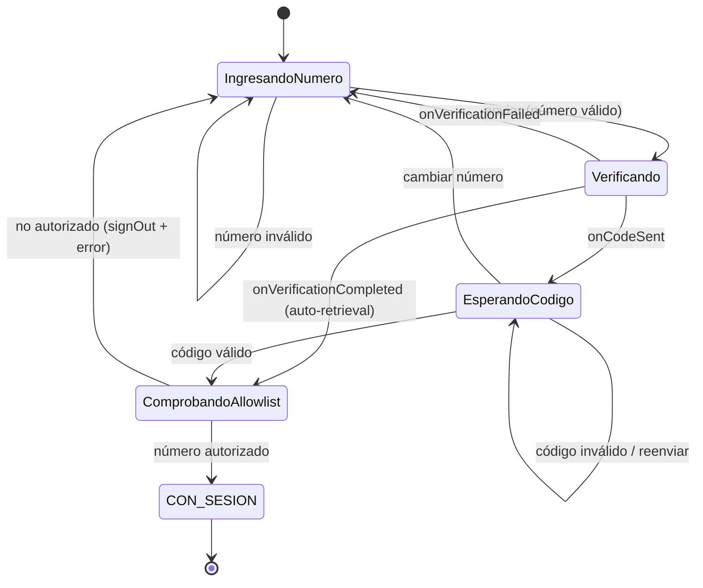

# Plan de implementación — Login por número de teléfono (Firebase Phone Auth)

## Problema

Hoy el login es Firebase Auth **correo+contraseña**. El identificador real del
usuario en campo es el **número de teléfono del equipo** (compartido entre
personas, lo cual no importa: el teléfono ES el usuario). Hay que reemplazar el
login por **verificación real por SMS (OTP)**, con el número como identidad. La
autorización de datos ya se apoya en el `uid` de Firebase, no en el correo, así
que el modelo de propiedad sobrevive; lo que cambia es el mecanismo de
autenticación y el campo de identidad visible (`correo` → `telefono`).

## Requisitos (confirmados)

1. **Verificación real por SMS** (Firebase Phone Auth), no correo/PIN.
2. El teléfono es el actor; **no** interesa quién de las personas del equipo actúa.
3. Gate de acceso = **la cuenta existe en Firebase**; sin lista dura en Firebase
   mientras estemos en Spark.
4. Los **analistas siguen por correo** (`config/analistas.correos`); esta parte
   NO se toca.
5. Costo de SMS / SIM por equipo aceptable.
6. **Allowlist app-side ahora (Spark)**, con `beforeCreate` blocking function como
   destino cuando se pase a Blaze (se deja escrita, se despliega después).
7. **`custodioCorreo` → `custodioTelefono` en TODAS partes**, incluido el documento
   de Firestore (el panel del analista lee el teléfono, no el correo). El panel es
   otro repo: se marcan todos los puntos para replicar allá.
8. **Task 4 (allowlist): opción B** — verificar la allowlist DESPUÉS de autenticar
   (para que la regla de lectura exija auth y no se filtre la lista de números).

## Antecedentes (verificado en el código)

- Única integración de Auth: `data/remote/AuthDataSource.kt`
  (`FirebaseAuthSesionRepositorio`), con `iniciarSesion(correo, contraseña)`,
  `observarCustodio()`, `cerrarSesion()` y `codigoSesionAError()`.
- Interfaz de dominio: `domain/repository/SesionRepositorio.kt`.
- Modelo: `domain/model/Custodio.kt` = `data class Custodio(uid, correo)`.
- `correo`/`custodioCorreo` fluye por: `CrearReporte`, `ReporteMappers`,
  `ReporteEntity` (columna Room `custodioCorreo`), `DocumentoMappers` (campo
  Firestore `custodioCorreo` en `reportes/{id}`), `AjustesScreen`/`AjustesViewModel`,
  `DialogoCerrarSesion` (`ui/components/Dialogos.kt`), `DatosDemo`.
- **Autorización**: reglas Firestore/Storage usan solo
  `custodioUid == request.auth.uid`. El correo del token solo lo usa
  `esAnalista()`. → renombrar `custodioCorreo` **no** afecta autorización.
- Room: `AppCustodioDatabase` en **version = 3**, con migraciones `MIGRACION_1_2`,
  `MIGRACION_2_3` y el patrón de dropear/recrear el índice único parcial en cada
  migración. La columna `custodioCorreo` es `NOT NULL`.
- Errores: `DominioError` (sealed) → `ui/error/DominioErrorRecurso.kt` (`aRecurso()`)
  → strings. Test existente `AuthErrorMappingTest`.
- Emulador: `firebase/firebase.json` ya expone auth en `127.0.0.1:9099`. Seed
  `firebase/seed/auth_export/accounts.json` tiene 1 cuenta de correo.
- DI: `di/AuthModule.kt` provee `FirebaseAuth` (con `useEmulator` en modo emulador)
  y `SesionRepositorio`.

## Nota sobre el .xlsx de teléfonos

`docs/INFORMACION UNIDADES DE TRAMO-TELEFONOS.xlsx` es binario; no se puede leer con
las herramientas de texto del agente. Para el script de aprovisionamiento se
necesitan los números en **texto E.164** (p. ej. `+593999888777`). En la tarea de
aprovisionamiento el script leerá un **CSV** exportado del xlsx (una columna de
números); hay que entregar ese CSV o pegar la lista en el chat.

## Solución de alto nivel

Reemplazar el flujo correo+contraseña por una **máquina de estados de dos fases**:
(1) ingreso de número → `verifyPhoneNumber`; (2) ingreso del código SMS →
`signInWithCredential`, con reenvío+cooldown, auto-retrieval, y errores de código
inválido/expirado/rate-limit. La identidad pasa a `Custodio(uid, telefono)`. Se
renombra `custodioCorreo`→`custodioTelefono` en modelo, Room (con migración 3→4),
Firestore y UI. La allowlist app-side (doc Firestore `config/telefonos`) se
consulta **después de autenticar** (opción B): si el número no está, se hace
`signOut` y se muestra error. Analistas intactos.

## Decisiones de diseño y trade-offs

- **Allowlist app-side es blanda**: un APK modificado podría saltarla y Firebase
  auto-crearía el usuario. Los **datos** siguen protegidos por `uid` en las reglas
  (un usuario solo escribe lo suyo). Enforcement duro llega con la `beforeCreate`
  en Blaze, que leerá el **mismo** doc `config/telefonos`. Sin retrabajo.
- **Opción B para la allowlist**: se verifica tras `signInWithCredential`, así la
  regla de lectura de `config/telefonos` puede exigir `request.auth != null` y no
  se expone la lista de números a clientes anónimos. Si el número no está en la
  lista: `signOut()` + error "número no autorizado".
- **Renombre vs. relleno**: renombramos `custodioCorreo`→`custodioTelefono` de punta
  a punta. Requiere migración Room 3→4 (no destructiva) y cambio del contrato
  Firestore. **Punto de coordinación cross-repo**: el panel del analista debe leer
  `custodioTelefono`.
- **Emulador y SMS**: el Auth emulator no envía SMS; usa números ficticios con
  código fijo (se configuran en la Emulator UI / al vuelo, no en `accounts.json`).
  Los tests de reglas (`npm test`) usan su motor in-process por `uid` y **no**
  dependen del correo; solo hay que cambiar `custodioCorreo`→`custodioTelefono` en
  los fixtures que lo usen.
- **Sesión viva**: Phone Auth refresca token igual que correo; no se fuerza
  re-verificación estando logueado. No se toca el guard de cierre de sesión con
  pendientes.
- **Dependencias/Sync**: `firebase-auth` (vía BoM) ya incluye la API de Phone Auth
  → **no** se prevé cambio en `libs.versions.toml`/`build.gradle.kts`. Se confirma
  antes de codificar; **si hiciera falta un dep, el agente se detiene y espera el
  Sync** (regla del proyecto). El **SHA-256** en la consola y **habilitar el
  proveedor Teléfono** en Authentication son tarea del humano.
- **CHANGELOG**: cada tarea agrega su entrada en español al inicio de `CHANGELOG.md`
  con timestamp, resumen, cambios y archivos (regla obligatoria).

## Alcance / fuera de alcance

- Fuera: cambiar el login de analistas; desplegar la blocking function (se escribe,
  se despliega en Blaze); editar el panel web (otro repo); leer/parsear el .xlsx
  binario.

## Desglose de tareas

Cada tarea deja un incremento compilable y demostrable, empezando por el dominio y
terminando en el cableado y las pruebas. Regla de verificación:
`./gradlew testDebugUnitTest` y `./gradlew assembleDebug` deben quedar verdes; para
reglas, `cd firebase && npm test`.

### Task 1: Renombrar identidad `correo`→`telefono` en dominio + migración Room 3→4

- Objetivo: cambiar `Custodio.correo`→`telefono`; `Reporte.custodioCorreo`→
  `custodioTelefono`; `ReporteEntity` columna `custodioCorreo`→`custodioTelefono`;
  `ReporteMappers`; `CrearReporte`; `DatosDemo`. Subir `AppCustodioDatabase.version`
  a 4 y añadir `MIGRACION_3_4` que renombre la columna (patrón dropear/recrear
  índice único ya establecido; `RENAME COLUMN` en SQLite soportado, con la premisa
  de no perder datos).
- Guía: seguir exactamente el patrón de `MIGRACION_2_3` (drop índice al entrar;
  `onOpen` lo recrea). Columna sigue `NOT NULL`.
- Pruebas: test de migración 3→4 al estilo `MigracionIndiceActivoTest` verificando
  que el dato viejo (`custodioCorreo`) queda en `custodioTelefono`; actualizar
  cualquier test de `CrearReporte`/mappers.
- Demo: `testDebugUnitTest` verde; una base v3 migra a v4 conservando el valor en
  la nueva columna.

### Task 2: Contrato Firestore `custodioCorreo`→`custodioTelefono` (app) + fixtures de reglas

- Objetivo: en `DocumentoMappers.aDocumentoFirestore()` renombrar la clave
  `"custodioCorreo"`→`"custodioTelefono"`. Revisar `firebase/test/reglas.test.js` y
  cualquier fixture que escriba `custodioCorreo` y renombrarlo (las reglas mismas no
  leen ese campo, solo `custodioUid`, así que `.rules` no cambia).
- Guía: dejar comentario en el mapper marcando el punto de coordinación con el panel.
- Pruebas: `cd firebase && npm test` verde.
- Demo: un reporte subido al emulador tiene el campo `custodioTelefono`; reglas
  verdes.

### Task 3: `SesionRepositorio` + `AuthDataSource` — flujo Phone Auth (OTP)

- Objetivo: cambiar la interfaz `SesionRepositorio` de `iniciarSesion(correo,
  contraseña)` a una API de dos pasos, p. ej.: `enviarCodigo(telefono,
  activity/callbacks): Flow<EventoVerificacion>` (que emita
  `CodigoEnviado(verificationId, resendToken)`, `VerificacionAutomatica`,
  `Fallo(error)`) y `verificarCodigo(verificationId, codigo): Result<Custodio>`;
  más `reenviarCodigo(...)`. Implementar en `FirebaseAuthSesionRepositorio` con
  `PhoneAuthProvider.verifyPhoneNumber(PhoneAuthOptions...)` y
  `OnVerificationStateChangedCallbacks` (`onCodeSent`, `onVerificationCompleted`,
  `onVerificationFailed`), y `signInWithCredential`. Construir
  `Custodio(uid, telefono = usuario.phoneNumber.orEmpty())`. `observarCustodio()` y
  `cerrarSesion()` cambian solo el campo `telefono`.
- Errores: añadir a `DominioError` los casos de teléfono necesarios (p. ej.
  `NumeroInvalido`, `CodigoInvalido`, `CodigoExpirado`, reutilizar `SinConexion`,
  mapear `TOO_MANY_REQUESTS`→un `DemasiadosIntentos`). Reemplazar `codigoSesionAError`
  por el mapeo de errores de Phone Auth (`FirebaseAuthInvalidCredentialsException`
  para código malo, `FirebaseTooManyRequestsException`,
  `FirebaseAuthMissingActivityForRecaptchaException`, etc.).
- Nota de acoplamiento a Activity: `verifyPhoneNumber` requiere una `Activity`.
  Definir cómo se provee (parámetro desde la capa UI). Mantener el repositorio
  testeable aislando el SDK.
- Pruebas: reescribir `AuthErrorMappingTest` para los códigos de Phone Auth (mapeo
  puro, sin device).
- Demo: `testDebugUnitTest` verde con el nuevo mapeo de errores.

### Task 4: Allowlist app-side (`config/telefonos`) + regla de lectura — OPCIÓN B

- Objetivo: crear un pequeño repositorio/uso que lea el doc Firestore
  `config/telefonos` (campo `telefonos: array`) y exponga `estaAutorizado(e164):
  Boolean`. En `firestore.rules`, permitir `read` de `config/telefonos` a
  **autenticados** (hoy `config/{documento}` es `read,write:false`); mantener
  `config/analistas` sin lectura de cliente.
- **Opción B (elegida)**: la allowlist se verifica **después** de autenticar. Flujo:
  SMS → `signInWithCredential` → leer `config/telefonos` (ya autenticado) →
  si el número NO está: `signOut()` + error "número no autorizado". Así la regla
  exige auth y la lista de números no se expone a clientes anónimos.
- Guía: reutilizar el estilo de `esAnalista()`/`config` documentado en las reglas.
- Pruebas: test de reglas para lectura de `config/telefonos` (autenticado sí,
  anónimo no); test unitario del repositorio de allowlist con fake.
- Demo: en emulador, un número fuera de la lista es rechazado tras verificar; uno
  dentro entra.

### Task 5: UI de login de dos fases (`LoginUiState`/`LoginViewModel`/`LoginScreen`)

- Objetivo: convertir `LoginUiState` en máquina de estados (`fase:
  IngresandoNumero|EsperandoCodigo`, `telefonoEscrito`, `codigoEscrito`,
  `verificationId`, `resendToken`, `segundosParaReenviar`, `verificando`,
  `@StringRes error`). `LoginViewModel` maneja callbacks del repositorio, el
  temporizador de cooldown de reenvío, auto-retrieval, y el check de allowlist
  (opción B, tras autenticar). `LoginScreen` renderiza dos fases (o dos composables
  `FaseNumero`/`FaseCodigo`) con `KeyboardType.Phone`, botón reenviar con cuenta
  regresiva, y estados de error. Actualizar previews (usar teléfono demo).
- Guía: mapear errores con `aRecurso()`; nuevas strings en `strings.xml` (retirar
  `login_subtitulo`/`login_correo`/`login_contrasena`/`login_error_correo`/
  `login_error_contrasena` obsoletas y añadir las de número/código/reenvío/errores).
- Pruebas: test de ViewModel (con fake `SesionRepositorio`) para transiciones de
  fase, cooldown, allowlist rechazada, código inválido.
- Demo: en emulador con número ficticio + código fijo, el login completa las dos
  fases y navega a `inicio`.

### Task 6: Ajustes + diálogo de cierre muestran teléfono

- Objetivo: `AjustesScreen` (`ajustes_sesion_activa`) mostrar `custodio?.telefono`;
  `DialogoCerrarSesion(correo=...)`→`telefono` en `ui/components/Dialogos.kt` y sus
  previews; `AjustesViewModel` intacto salvo el campo. Confirmar que el guard de
  cierre con pendientes y el `cancelarTodo()` antes de `signOut()` no se tocan.
- Pruebas: previews compilan; no hay cambio de lógica de bloqueo.
- Demo: en Ajustes se ve el número; cierre de sesión sigue bloqueado con pendientes.

### Task 7: Emulador/seed + strings + wiring final + verificación completa

- Objetivo: actualizar `firebase/seed/auth_export/accounts.json` a una cuenta de
  teléfono (con la salvedad de que el OTP no se puede sembrar; documentar el número
  ficticio y código en README). Ajustar `di/AuthModule.kt` si la nueva API del
  repositorio requiere pasar Activity/campos. Barrer strings sobrantes. Correr
  `./gradlew testDebugUnitTest`, `./gradlew assembleDebug`, `cd firebase && npm test`;
  limpiar temporales.
- Pruebas: build + unit + reglas verdes; smoke manual en emulador documentado.
- Demo: app compila, tests verdes, login por teléfono funciona en emulador de punta
  a punta.

### Task 8: Aprovisionamiento (Admin SDK) + `beforeCreate` para Blaze + README

- Objetivo: script Node bajo `firebase/` que lea un CSV de números E.164 y por cada
  uno: `admin.auth().createUser({ phoneNumber })` **y** agregue el número al doc
  `config/telefonos`. Escribir la Cloud Function `beforeCreate` (rechaza números
  fuera de `config/telefonos`) lista para desplegar en Blaze, sin activarla en
  Spark. README: pasos de aprovisionamiento, alta del proveedor Teléfono, SHA-256, y
  la nota Spark→Blaze.
- Guía: se requiere el CSV (exportado del .xlsx) o la lista en texto; el agente no
  puede leer el binario.
- Pruebas: correr el script contra el emulador Auth y verificar usuarios creados +
  doc allowlist poblado.
- Demo: script crea los usuarios de teléfono en el emulador y llena
  `config/telefonos`; la función queda en el repo para Blaze.

## Puntos donde el agente se detiene a confirmar

- **Task 3**: cómo inyectar la `Activity` que exige `verifyPhoneNumber` (afecta la
  firma del repositorio).
- **Antes de codificar**: verificar si `firebase-auth` del BoM ya trae Phone Auth;
  **si necesitara dep nuevo, detenerse por el Sync**.
- **Task 8**: se necesita el CSV/lista de números en texto E.164.

## Tareas del humano (consola Firebase)

- Habilitar el proveedor **Teléfono** en Authentication.
- Registrar el **SHA-256** de la app en el proyecto Firebase (anti-abuso /
  Play Integrity).
- Al pasar a Blaze: desplegar la Cloud Function `beforeCreate` (Task 8).
