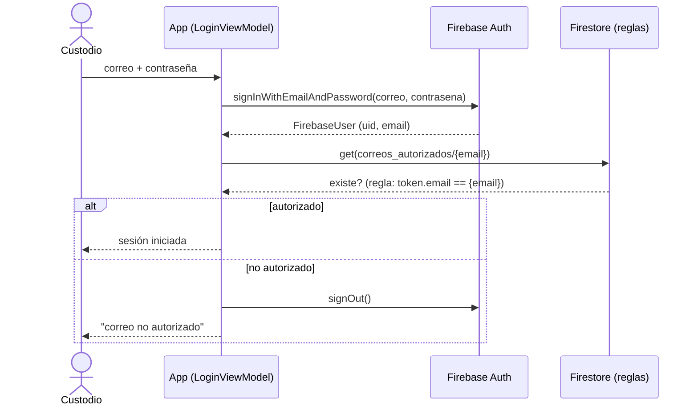

# PLAN_EMAIL_AUTH — Login del custodio por correo + contraseña (retiro del OTP por SMS)

> **Alcance de este documento: la app `pf-app-custodio`.** Los cambios de perímetro (reglas de
> Firestore, función `beforeCreate`, aprovisionamiento y seed) viven en `pf-infra-firebase` y se
> planean en el documento raíz del workspace (`../../../PLAN-AUTH-CUSTODIO-CORREO.md`). Aquí solo se
> detalla lo que se toca dentro de este repo, más las dependencias externas que condicionan el
> despliegue.
>
> **Requisito de lectura previa:** `docs/GENERIC_RULES.md` (exigido por el `AGENTS.md` de este repo)
> antes de modificar código.

---

## Por qué

El login del custodio usa Firebase Phone Auth (OTP por SMS). El SMS no se envía o no se recibe de
forma confiable en campo, y eso deja al custodio fuera de la app. Se reemplaza el método por
**correo + contraseña**, que no depende de la entrega de un mensaje en el momento del login:
`signInWithEmailAndPassword` resuelve contra Firebase Auth sin `Activity`, sin reCAPTCHA y sin
round-trip de OTP.

Es un **cutover completo, sin retrocompatibilidad**: la identidad del custodio pasa de teléfono a
correo en todo el repo (dominio, persistencia, contrato Firestore, UI y analítica). El teléfono se
conserva **solo como dato informativo**; ya no es llave de autenticación ni de autorización.

## Qué NO cambia (fuera de alcance)

- Flujo de auto-servicio de reseteo de contraseña y verificación de correo.
- `setUserId` y el evento `logout` de analítica (siguen fuera de alcance, como en `PLAN_ANALYTICS_LOGIN.md`).
- El keystore de release: **congelado**, no se toca.
- El nombre del archivo Room `app_custodio.db` (legacy de nomenclatura, sin efecto).

---

## Estado actual verificado (lo que hay que desmontar)

- Identidad: `Custodio(uid, telefono)` detrás de `SesionRepositorio`, `AllowlistRepositorio` y el
  modelo `EventoVerificacion`. La abstracción está limpia, así que el cambio es contenible.
- Login de **dos fases** (número → OTP): `PhoneAuthProvider` vía `PhoneAuthOptions`, callback
  `OnVerificationStateChangedCallbacks`, watchdog de 30 s contra el broker de GMS mudo
  (`DominioError.SinRespuestaSms`), y reenvío con `ForceResendingToken` opaco en el repo. **Todo ese
  andamiaje se elimina.**
- Allowlist: `FirestoreAllowlistRepositorio.contiene(telefono)` hace `get()` a
  `telefonos_autorizados/{e164}` y devuelve `exists()`, consultada **después** de autenticar
  (opción B). La lectura está aislada en ese método.
- Contrato de datos: campo `custodioTelefono` en `reportes` — columna Room, migración 3→4
  (`MIGRACION_3_4`), y contrato Firestore.
- Analítica: `MetodoAuth.PHONE` + nueve `ResultadoLogin`, instrumentados en seis puntos de
  `LoginViewModel`, **sin PII**. Cuatro desenlaces son específicos de SMS
  (`SIN_RESPUESTA_SMS`, `NUMERO_INVALIDO`, `CODIGO_INVALIDO`, `CODIGO_EXPIRADO`).

## Convención de nombres

Sustantivos de dominio en español: `correo` es la forma canónica (como `telefono` hoy). Se usan
`correo`, `correos_autorizados`, `custodioCorreo`, `CorreoNoAutorizado`. Prosa y comentarios en
español (México); identificadores técnicos en inglés.

---

## Flujo nuevo (una sola fase)

El patrón "autenticar → consultar allowlist → cerrar sesión si no autorizado" (opción B) **se
conserva**: solo cambia la llave de teléfono a correo. El desenlace se registra **antes** de
`cerrarSesion()`, como hoy.

---

## Archivos de este repo que se tocan

- `domain/model/Custodio.kt`
- `domain/model/EventoVerificacion.kt` — **se elimina**
- `domain/repository/SesionRepositorio.kt`
- `domain/repository/AllowlistRepositorio.kt`
- `domain/error/DominioError.kt`
- `data/remote/AuthDataSource.kt` (`FirebaseAuthSesionRepositorio` + mapeo de errores)
- `data/remote/FirestoreAllowlistRepositorio.kt`
- `data/diagnostico/RegistroDeEventos.kt` (`MetodoAuth`, `ResultadoLogin`, `aResultadoLogin`)
- `ui/login/{LoginViewModel,LoginUiState,LoginScreen}.kt`
- `ui/error/DominioErrorRecurso.kt`
- `data/local/db/EchoDatabase.kt` (migración `MIGRACION_4_5`, `schemaVersion`) + la entidad `reportes` y `DocumentoMappers`/DAO
- `res/values/strings.xml` (`login_*`, `error_*`)
- `di/AuthModule.kt` (sin cambio estructural esperado; el binding sigue igual)
- Tests: `AuthErrorMappingTest.kt`, `LoginViewModelTest`, `ResultadoLoginTest.kt`,
  `MigracionCorreoATelefonoTest.kt` (→ `MigracionTelefonoACorreoTest`)

---

## Tareas (verificables una a una)

Verificación de cada tarea de la app: `./gradlew testDebugUnitTest` + `./gradlew assembleDebug`.
**Pausa para Sync** si se toca `libs.versions.toml`/`build.gradle.kts` — **no se espera**: Firebase
Auth ya está en el BoM. Las tareas 5–8 son secuenciales porque comparten la frontera de tipos que
el compilador va exigiendo.

> La numeración (5–8) se mantiene alineada con el plan raíz del workspace; las tareas 1–4 (infra) y
> la 9 (panel + despliegue) viven allá.

### Task 5 — Modelo de dominio: `Custodio(uid, correo)`, `SesionRepositorio` de una fase, allowlist por correo, `DominioError`

- `Custodio.telefono` → `Custodio.correo`.
- `SesionRepositorio` se reduce a:
  - `fun observarCustodio(): Flow<Custodio?>`
  - `suspend fun iniciarSesion(correo: String, contrasena: String): Result<Custodio>`
  - `suspend fun cerrarSesion(): Result<Unit>`
  - Se eliminan `enviarCodigo`/`reenviarCodigo`/`verificarCodigo`.
- Se elimina `domain/model/EventoVerificacion.kt`.
- `AllowlistRepositorio.contiene(correo)`.
- `DominioError`: retirar los casos exclusivos de SMS (`NumeroInvalido`, `CodigoInvalido`,
  `CodigoExpirado`, `SinRespuestaSms`); renombrar `TelefonoNoAutorizado` → `CorreoNoAutorizado`;
  agregar `CredencialesInvalidas` y `CuentaDeshabilitada`. Se mantienen `DemasiadosIntentos`,
  `SinConexion`, `ServidorIndisponible`, `Inesperado` y todos los de reporte/medio.

**Cambios guiados por el compilador** (interfaces selladas + `when` exhaustivo sin `else`).

**Demo:** el dominio expresa identidad por correo y login de una fase; el proyecto aún no compila
entero (se cierra en 6–8).

### Task 6 — `FirebaseAuthSesionRepositorio` con `signInWithEmailAndPassword`; allowlist por correo; mapeo de errores

- Reescribir `AuthDataSource.kt`: `iniciarSesion` llama
  `auth.signInWithEmailAndPassword(correo, contrasena).await()` y mapea el `FirebaseUser` a
  `Custodio(uid, email)`. Eliminar todo el andamiaje de `PhoneAuthProvider`/`PhoneAuthOptions`,
  callbacks, watchdog del broker y tokens de reenvío.
- Reescribir `excepcionSesionAError`/`mapearErrorAutenticacion` para los códigos de correo:
  `ERROR_INVALID_EMAIL`, `ERROR_WRONG_PASSWORD`/`ERROR_INVALID_CREDENTIAL`, `ERROR_USER_DISABLED`,
  `ERROR_USER_NOT_FOUND`, `ERROR_TOO_MANY_REQUESTS`, `ERROR_NETWORK_REQUEST_FAILED`. Conservar la
  función **pura** `mapearErrorAutenticacion` (probable en JVM sin clases de Firebase).
- `FirestoreAllowlistRepositorio.contiene(correo)`: `get()` a
  `correos_autorizados/{correo-normalizado en minúsculas}`, devuelve `exists()`; conservar el cierre
  seguro por omisión (documento inexistente → nadie autorizado) y el envoltorio `ejecutarRemoto`.

**Test:** adaptar `AuthErrorMappingTest.kt` a los códigos de correo (sustituir los de número/código);
agregar test del repositorio de allowlist si aplica.

**Demo:** `iniciarSesion` autentica por correo y el mapeo de errores pasa sus pruebas de unidad.

### Task 7 — `LoginViewModel` + `LoginUiState` + `LoginScreen` de una sola fase

- `LoginUiState` → `{ correoEscrito, contrasenaEscrita, autenticando, error }`. Se eliminan
  `FaseLogin`, `codigoEscrito`, `enviandoSms`, `verificando`, `segundosParaReenviar`.
- `LoginViewModel`: un método `iniciarSesion()` que valida el formato del correo, llama
  `sesionRepositorio.iniciarSesion(...)` y en éxito valida la allowlist por correo, registrando el
  desenlace **antes** de `cerrarSesion()` cuando rechaza. Se eliminan cuenta regresiva, reenvío,
  `regresarANumero` y el uso del `Activity`.
- `LoginScreen`/`LoginRoute`: una sola pantalla con campo de correo, campo de contraseña
  (`PasswordVisualTransformation`) y botón "Iniciar sesión". Quitar el `Activity` y el `BackHandler`
  de la fase OTP; actualizar las `@Preview`.
- `strings.xml`: textos de login por correo y mensajes de error nuevos; retirar los de SMS/OTP
  (`login_codigo_enviado`, `login_reenviar`, etc.). `DominioErrorRecurso.kt`: mapear los
  `DominioError` nuevos y quitar los eliminados.

**Test:** adaptar `LoginViewModelTest` al flujo de una fase; mantener los fakes de
`SesionRepositorio`/`AllowlistRepositorio`.

**Demo:** la pantalla pide correo + contraseña, autentica, y bloquea a un correo fuera de la
allowlist.

### Task 8 — Analítica por correo + Room 4→5 + persistencia/UI teléfono → correo

- `RegistroDeEventos.kt`: `MetodoAuth.EMAIL`; recortar `ResultadoLogin` a `OK`, `CORREO_INVALIDO`,
  `CREDENCIALES_INVALIDAS`, `CORREO_NO_AUTORIZADO`, `DEMASIADOS_INTENTOS`, `SIN_CONEXION`,
  `INESPERADO`; reescribir `aResultadoLogin()` **exhaustivo y sin `else`** (el compilador avisa al
  agregar variantes a `DominioError`).
- Room: entidad `reportes` `custodioTelefono` → `custodioCorreo`; `schemaVersion` a 5;
  `MIGRACION_4_5` (`ALTER TABLE reportes RENAME COLUMN custodioTelefono TO custodioCorreo`, con
  `DROP_INDICE_UNICO_ACTIVO` como las previas), registrada en `addMigrations`. Es el **espejo** de la
  `MIGRACION_3_4`. Actualizar `DocumentoMappers`, el DAO y todo punto que lea `custodioTelefono`.
- UI: Ajustes y cierre de sesión muestran el **correo** donde hoy muestran el teléfono.

**Test:** renombrar `MigracionCorreoATelefonoTest.kt` → `MigracionTelefonoACorreoTest` (una base v4
migra a `custodioCorreo` conservando el valor); `ResultadoLoginTest` cuenta las variantes nuevas.
`testDebugUnitTest` + `assembleDebug` verdes.

**Demo:** la app compila, corre y emite `login` con método `EMAIL` y el desenlace correcto; una base
v4 migra a `custodioCorreo` sin perder datos.

---

## Dependencias externas (fuera de este repo, condicionan el despliegue)

Estas viven en `pf-infra-firebase` y se detallan en el plan raíz. Se listan aquí porque el login por
correo **no funciona sin ellas**:

1. **Regla Firestore** `correos_autorizados/{email}` (`request.auth.token.email == email`) y el
   contrato `custodioCorreo`; retiro de `telefonos_autorizados/{e164}`.
2. **`beforeCreate`** autoriza por existencia de `correos_autorizados/{email}` (ya no por teléfono).
3. **Aprovisionamiento**: cuentas email+password con contraseña del CSV (patrón `Bravo-****-ai27`
   para usuarios B; propia para nombrados), dominio `@ai27.com`, teléfono conservado como dato en
   `usuarios/{uid}`.
4. **Seed del emulador** re-exportado al modelo nuevo (para que el login pase contra el emulador).
5. **Panel del analista**: `custodioTelefono` → `custodioCorreo` en el mock del contrato.

**Orden de despliegue (blast radius alto, confirmación del usuario requerida):** desplegar reglas +
`beforeCreate` y correr el aprovisionamiento **junto con** la distribución del APK release nuevo.
Publicar uno sin el otro deja custodios sin acceso (precedente: incidente de keystore + id de
allowlist malformado). Verificar el login por correo en dispositivo real con el **APK release**
contra producción (el debug apunta al emulador vía `modo_emulador`).

---

## Verificación de cierre

- `./gradlew testDebugUnitTest` verde (incluida la migración 4→5 y `ResultadoLoginTest`).
- `./gradlew assembleDebug` verde.
- Sin cero referencias vivas a `PhoneAuthProvider`, `EventoVerificacion`, `telefonos_autorizados` ni
  `custodioTelefono` en `app/src/` (salvo menciones históricas en KDoc/CHANGELOG).
- Smoke test en dispositivo contra el emulador (debug) y, en el despliegue, contra producción (release).
- Actualizar `CHANGELOG.md`, el bloque PHONE_AUTH del `AGENTS.md` (queda stale) y `docs/PLAN.md`
  §2/§5 al cerrar.
