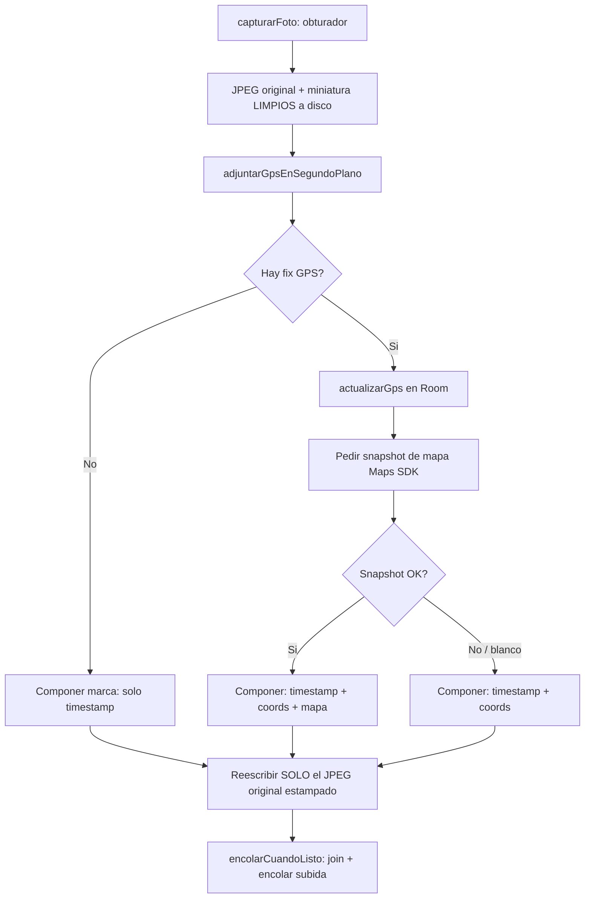

# PLAN_MARCA_DE_AGUA — Marca de agua en fotos de evidencia

> **Alcance de este documento: la app `pf-app-custodio` (Echo).** Toda la implementación vive
> dentro de este repo. El único paso que cae fuera del código es el **alta de la API key de Google
> Maps** en la consola de Google Cloud (paso humano), que se documenta más abajo.
>
> **Requisito de lectura previa:** `docs/GENERIC_RULES.md` (exigido por el `AGENTS.md` de este repo)
> antes de modificar código.

---

## Por qué

Hoy la foto que captura el custodio se guarda y se sube tal cual sale de la cámara, sin ninguna
marca sobre el pixel. La evidencia no acarrea, grabada en la propia imagen, ni cuándo ni dónde se
tomó. Este cambio graba una **marca de agua irreversible** sobre el JPEG original con tres datos:

- **Fecha y hora** de captura, formato `YYYY/MM/DD HH:MM:SS`, esquina **superior izquierda**.
- **Coordenadas GPS** (lat, lng), esquina **inferior derecha**.
- **Snapshot de un mapa** del punto de captura, esquina **inferior izquierda**.

El alcance es **solo fotos** (`TipoMedio.FOTO`). El audio no se toca.

## Requisitos acordados

1. **Sin fix de GPS → se graba la foto igual**, omitiendo coordenadas y mapa; el timestamp siempre
   va (no depende del GPS).
2. **El mapa se produce con el SDK de Google Maps en el dispositivo** (snapshot de un `GoogleMap`).
   Requiere API key en el manifest y red para bajar los tiles.
3. **Si el snapshot del mapa falla o viene en blanco** (sin conectividad en campo), se **omite solo
   el tile del mapa** pero se graban coordenadas + timestamp.
4. **La marca de agua se graba solo en el JPEG original, NO en la miniatura de 320 px.** La
   miniatura es preview interno; ahí el texto y el mapa serían ilegibles. Es, además, la operación
   más ligera: una sola pasada de `Canvas` y un re-encode, sobre el original.
5. **Composición diferida.** El obturador sigue siendo inmediato. En la captura se escribe un
   original + miniatura **limpios** (como hoy); cuando el GPS (y el snapshot) resuelven en segundo
   plano, se compone la marca y se **reescribe únicamente el archivo original** antes de encolar la
   subida.

### Decisiones de formato (confirmadas por el usuario)

- **Timestamp: hora LOCAL del dispositivo**, patrón `YYYY/MM/DD HH:MM:SS`, usando
  `ZoneId.systemDefault()`. **No** UTC.
- **Coordenadas: grados decimales**, 6 decimales con signo (p. ej. `19.432608, -99.133209`).
  **No** grados/minutos/segundos.

## Qué NO cambia (fuera de alcance)

- **El contrato de datos remoto.** La marca se graba en el pixel del JPEG; no se añaden campos a
  `medios` ni a `reportes`. (`sizeBytes` se refresca al reescribir el original, pero ya existe.)
- **El esquema de Room**: no hay migración nueva.
- **La miniatura de 320 px**: queda limpia, sin tocar.
- **El flujo de audio**: `detenerGrabacionDeAudio` y su encolado no pasan por la composición.
- **El obturador**: `capturarFoto` sigue persistiendo de inmediato sin esperar GPS ni mapa.
- **Mapa garantizado sin conexión**: precargar o empaquetar tiles queda explícitamente fuera.

---

## Estado actual verificado (puntos de enganche)

- **Flujo de captura** (`CapturaViewModel.capturarFoto`): codifica JPEG + miniatura con
  `Miniaturas.fotoOriginalYJpeg`, persiste de inmediato vía `CapturarMedio` con `gps = null`, y el
  GPS se adjunta **después, en segundo plano** (`adjuntarGpsEnSegundoPlano`, hasta 8 s, puede
  volver `null`). `encolarCuandoListo` hace `trabajosGps[medioId]?.join()` **antes** de encolar la
  subida — ese join es el punto de enganche de la composición diferida.
- **Escritura de archivos** (`FilesDirAlmacenArchivos.guardar`): usa `writeBytes`, que
  **trunca/sobrescribe**. Reescribir la misma ruta (`medio.id`) con el JPEG estampado es limpio. La
  ruta local vive en `Medio.localPath`.
- **El GPS ya se persiste** vía `RoomMedioRepository.actualizarGps` (solo mientras el medio sigue
  `PENDIENTE`). La marca se compone en el mismo momento en que ese `Gps` existe.
- **No hay Maps SDK ni API key hoy.** `gradle/libs.versions.toml` tiene `play-services-location`
  pero no `play-services-maps`. Es trabajo nuevo: dependencia + API key en el manifest +
  `MapView`/`GoogleMap.snapshot()` fuera de pantalla.
- **El snapshot de Maps es asíncrono** y necesita un `MapView` con lifecycle; no es una función
  pura. Hay que crearlo fuera de pantalla, esperar `onMapLoaded`, y llamar `snapshot {}`.
- **Archivos clave**: `ui/captura/CapturaViewModel.kt`, `ui/captura/VistaCamara.kt`,
  `data/local/media/Miniaturas.kt`, `data/local/archivo/FilesDirAlmacenArchivos.kt`,
  `data/repository/RoomMedioRepository.kt`, `domain/usecase/CapturarMedio.kt`,
  `domain/model/Gps.kt`, `data/ubicacion/ProveedorUbicacion.kt`.

---

## Solución propuesta

Separar la marca de agua en dos capas:

- **Dominio puro** (formateo de texto + geometría, testeable en JVM): sin Android.
- **Android** (dibujo en `Canvas`/`Bitmap` + snapshot de Maps): la parte que necesita el
  dispositivo.

La composición se dispara en el paso de GPS en segundo plano que ya existe, y reescribe solo el
archivo original.

---

## Desglose de tareas

### Task 1 — Composición pura de la marca de agua (dominio, sin Android)

Crear `domain/marcaDeAgua/` con:

- `MarcaDeAgua`: modelo con el timestamp ya formateado, el texto de coordenadas ya formateado (o
  `null`), y la bandera de si lleva mapa.
- `FormatoMarcaDeAgua`: formateador puro. Dado un `Instant` + `ZoneId` produce `YYYY/MM/DD HH:MM:SS`
  en hora **local**; dado un `Gps?` produce el texto de coordenadas en grados decimales (6
  decimales, con signo) o `null`.

**Test (JVM):** patrón de fecha exacto con padding de ceros (p. ej. `2026/01/05 09:03:07`), hora
local correcta dado un `ZoneId` fijo, coords con 6 decimales y signo (`19.432608, -99.133209`), y
el caso `Gps == null` → coords `null`.

### Task 2 — Dibujo de la marca sobre el bitmap (Android, sin mapa todavía)

Crear `data/local/media/DibujanteMarcaDeAgua` que recibe `Bitmap` + `MarcaDeAgua` (sin tile de mapa
aún) y dibuja: timestamp arriba-izquierda, coords abajo-derecha (si existen), con fondo
semitransparente para legibilidad y tamaño de fuente proporcional al lado del bitmap. Recomprime a
JPEG con `Miniaturas.CALIDAD_ORIGINAL`. La miniatura NO se toca.

**Test:** `androidTest` que estampa un bitmap de prueba y verifica que las regiones de las esquinas
cambiaron respecto al original; test JVM del cálculo de posiciones/tamaños si se extrae un layout
puro.

### Task 3 — Snapshot de mapa con Google Maps SDK (Android)

Añadir `play-services-maps` a `libs.versions.toml` + `build.gradle.kts`; API key de Maps vía
placeholder de manifest leído de `local.properties` (gitignored). **PAUSA para Sync** tras tocar los
scripts de build. Crear `data/mapa/ProveedorSnapshotMapa` (interface + impl) que, dado `Gps` y un
tamaño en px, crea un `MapView` fuera de pantalla, espera `onMapLoaded`, llama `snapshot {}` y
devuelve `Bitmap?` (`null` si falla, si se agota un timeout, o si viene en blanco). Sin red → `null`.

**Alta de API key (paso humano):** habilitar *Maps SDK for Android* en la consola de Google Cloud y
poner la key en `local.properties`. Se documenta en el README. Sin la key, el snapshot vuelve `null`
y las fotos salen con fecha+coords sin mapa (no rompe la captura).

**Test:** `FakeProveedorSnapshotMapa` para tests JVM del contrato; el impl real se valida
manualmente en dispositivo (Maps no corre en JVM).

### Task 4 — Componer mapa + texto en un solo estampado

Extender `DibujanteMarcaDeAgua` para aceptar un `Bitmap?` de mapa y dibujarlo abajo-izquierda (con
borde/recorte), omitiéndolo cuando es `null` (requisito 3). Crear el orquestador
`ComponerMarcaDeAgua` (en `data/`, inyectable) que ata formateo puro (Task 1) + snapshot de mapa
(Task 3) + dibujo (Task 2/4) y devuelve el `ByteArray` del JPEG estampado. Maneja los tres casos:
sin GPS (solo fecha), con GPS sin mapa (fecha+coords), con GPS y mapa (todo).

**Test:** JVM con fakes — con `Gps = null` no se pide snapshot; con `Gps` pero snapshot `null` se
dibuja sin mapa; con ambos se pasa el mapa al dibujante (dibujante aislado tras una interfaz).

### Task 5 — Enganchar la composición diferida y reescribir el original

Añadir a `MedioRepository` una operación `reescribirOriginal(medioId, bytes)` que sobrescribe el
archivo en `localPath` vía `almacenArchivos.guardar(medio.id, ...)` y actualiza `sizeBytes` en Room
(solo mientras `PENDIENTE`, igual que `actualizarGps`). En
`CapturaViewModel.adjuntarGpsEnSegundoPlano`: tras resolver el GPS (sea cual sea), leer el original
limpio, invocar `ComponerMarcaDeAgua`, y `reescribirOriginal`. `encolarCuandoListo` ya hace `join()`
del `trabajosGps[medioId]`, así que la subida espera sin cambios adicionales. Solo aplica a `FOTO`.

**Test:** `CapturaViewModelTest` (JVM, fakes) — tras capturar foto, el flujo llama a componer y a
reescribir el original antes de `encolarSubidaMedio`; el audio NO pasa por la composición; con GPS
`null` se compone igual (solo fecha).

### Task 6 — Verificación integral y documentación

Correr `testDebugUnitTest` y `assembleDebug` verdes. Prueba manual en dispositivo: (a) con red +
permiso de ubicación → foto con fecha+coords+mapa; (b) sin permiso → foto solo con fecha; (c) con
permiso pero en modo avión → foto con fecha+coords, sin mapa. Confirmar que la miniatura queda
limpia y que el obturador sigue inmediato. Documentar el alta de la API key de Maps (consola de
Google Cloud + `local.properties`) en el README, y anotar el cambio en `CHANGELOG.md` según el
estilo del repo.

---

## Notas / riesgos

- **Doble escritura del original** (limpio y luego estampado): intencional y acordada; solo el
  original, solo fotos, evita bloquear el obturador.
- **El snapshot de Maps necesita red**; en campo sin conectividad el mapa se omitirá a menudo
  (requisito 3 lo cubre). Mapa garantizado sin conexión queda FUERA de alcance.
- **Alta de la API key de Maps**: paso humano en la consola de Google Cloud; el código la lee de
  `local.properties`. Nunca se commitea.
- **PAUSA para Sync** tras tocar `libs.versions.toml` y `build.gradle.kts` (Task 3), antes de
  verificar.

---

## Estado de implementación (2026-10-01)

Implementado y verificado en JVM/build:

- Tasks 1–5 completas. `testDebugUnitTest` **253/253** y `assembleDebug` verdes;
  `compileDebugAndroidTestKotlin` verde.
- Tests nuevos: `FormatoMarcaDeAguaTest`, `DisposicionMarcaDeAguaTest`,
  `ComponerMarcaDeAguaTest`, y tres casos en `CapturaViewModelTest` (con GPS estampa
  fecha+coords y reescribe el original; sin fix solo fecha y no pide mapa; el audio no se
  estampa).
- **Sin migración de Room**: el contrato de datos no cambia; solo se refresca `sizeBytes` al
  reescribir el original estampado.

Pendiente de dispositivo (no verificable sin equipo en esta sesión):

- Test instrumentado `DibujanteMarcaDeAguaTest` (dibujo real sobre `Bitmap`/`Canvas`).
- Snapshot real del Maps SDK y los tres escenarios de campo (con red, sin permiso, modo
  avión) descritos en el README.

Pendiente humano:

- Alta de la **`MAPS_API_KEY`** en Google Cloud (Maps SDK for Android) y su colocación en
  `local.properties`. Sin ella la app funciona, pero las fotos salen con fecha+coords sin el
  tile de mapa.

---

## Verificación en dispositivo (2026-10-01)

Probado en un **CPH2769 (Android 16)** con el **APK release contra producción**
(`custodio-906e7268`):

- La foto sube a **Storage** en `medios/{reporteId}/{medioId}.jpg` (el original estampado) y
  su documento a Firestore con `storagePath`/`thumbnailPath` correctos. **Confirmado el blob
  en Storage de producción.**
- La **marca se ve grabada**: fecha arriba-izquierda, coordenadas abajo-derecha y el **tile
  de mapa** abajo-izquierda (con la `MAPS_API_KEY` y la huella SHA-1 del certificado de
  release dadas de alta en la key de GCP). La **miniatura queda limpia**.

### Nota: quirk del Emulator Suite de Storage

Al probar primero con el **APK debug contra el Emulator Suite**, el documento del medio
aparecía en Firestore pero **el blob no en Storage del emulador**. La causa es
`FirebaseMedioRemoto.objetoExiste()`: contra el emulador de Storage, `metadata.await()` de un
objeto inexistente **no** lanza `ERROR_OBJECT_NOT_FOUND` (como sí hace producción), así que
`subirSiNoExiste` cree que el blob ya está y **se salta el `putBytes`**. Es un comportamiento
**solo del emulador** y es **ajeno a la marca de agua** (el pipeline de subida es previo a
este cambio). En **producción el blob sube correctamente**, como se verificó arriba. Queda
anotado como hallazgo para pruebas futuras contra el emulador.

> **Recordatorio operativo para probar en debug/emulador:** abrir los túneles
> `adb reverse` (8080/9099/9199) **y reiniciar la app** antes de capturar. Las instancias de
> `FirebaseFirestore`/`FirebaseStorage` son singletons y, si el proceso arrancó antes de los
> túneles, quedan clavadas a producción para toda la vida del proceso.
