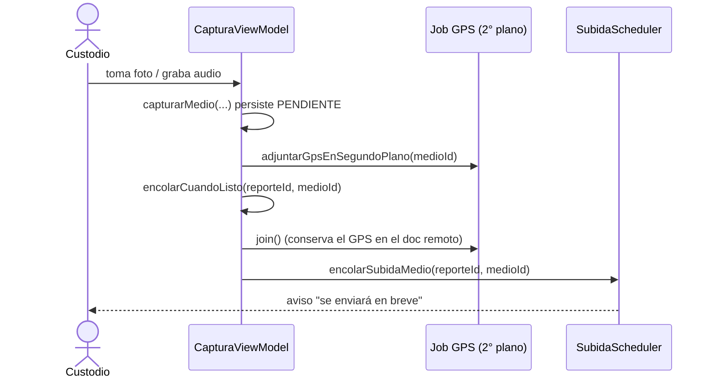

# PLAN_RETIRO_ETIQUETADO — Captura sin etiquetado y subida inmediata

> **Alcance de este documento: la app `pf-app-custodio` (Echo).** El cambio toca también el
> perímetro de Firebase y el panel del analista; cada uno se planea en su propio repo:
> `../../pf-infra-firebase/docs/PLAN_RETIRO_ETIQUETADO.md` y
> `../../pf-web-frontend-analist-panel/docs/PLAN_RETIRO_ETIQUETADO.md`. Aquí solo se detalla lo
> que se toca dentro de este repo.
>
> **Requisito de lectura previa:** `docs/GENERIC_RULES.md` (exigido por el `AGENTS.md` de este repo)
> antes de modificar código.

---

## Por qué

Hoy toda foto o nota de voz obliga a clasificar antes de servir: al capturar se abre `HojaEtiqueta`,
que exige al menos una etiqueta de categoría `SITUACION`, y `SubidaMedioProceso` convierte esa
etiqueta en un **candado duro de subida** —un medio sin `SITUACION` nunca sale del dispositivo
(`if (!esSituacion) return`)—. El etiquetado estorba al custodio en campo y retrasa el cierre del
viaje.

La captura pasa a ser lo más simple posible: **tomar foto o audio y que suba de inmediato apenas la
conexión lo permita**. Se retira el etiquetado y, de paso, el interruptor de "novedad" del cierre,
que también se consideró innecesario. El cierre conserva el campo de comentario opcional.

Es un retiro **por comentado, no por borrado**. Nada del código de etiquetado se elimina: se deja
inerte y comentado para poder reactivarlo sin reconstruirlo. **El contrato de datos no cambia.**

## Qué NO cambia (fuera de alcance)

- El contrato de datos: el campo `etiquetas` de `medios`, la columna Room `tieneSituacion`, el
  catálogo `catalogos/etiquetas` y el campo `hayNovedad` de `reportes` **se conservan**.
- El esquema de Room: **no hay migración nueva**. La columna `tieneSituacion` y `MIGRACION_1_2`
  quedan como están.
- El perímetro de Firebase: ya acepta medios sin etiqueta; no se despliega ningún cambio de
  comportamiento desde este repo (ver el plan de `pf-infra-firebase`).
- El keystore de release, el package/`applicationId` y el nombre del archivo Room.
- La captura de GPS en segundo plano por medio: se conserva tal cual (ver tarea 1).

---

## Estado actual verificado (lo que hay que inertizar)

- **Captura → etiquetado → encolado.** `CapturaViewModel.capturarFoto` y `detenerGrabacionDeAudio`
  persisten el medio y lo dejan en `medioPendienteDeEtiquetar`; `HojaEtiqueta` se abre encima. El
  **encolado de la subida ocurre solo dentro de `guardarEtiqueta`**, después de esperar el job de
  GPS en segundo plano (`trabajosGps.remove(medioId)?.join()`).
- **Candado de subida.** `SubidaMedioProceso.ejecutar` lee el catálogo (`EtiquetaRepository`) y
  retorna sin subir cuando el medio no tiene una `SITUACION`.
- **Reconciliación filtrada.** `MedioDao.obtenerPendientes` filtra `AND m.tieneSituacion = 1`, así
  que la reposición de la cola al arrancar ignora los medios sin clasificar. (En cambio
  `observarPendientesDe` y `contarPendientes` ya filtran solo por `estadoSubida != 'COMPLETA'`.)
- **UI de etiquetado.** `HojaEtiqueta` (en `ui/captura/`), su invocación en
  `CapturaEvidenciaScreen` y en `ArchivosScreen`, el aviso "faltan N por clasificar", el borde y el
  clic de "etiquetar ahora" de la celda, y los chips de etiqueta en la rejilla.
- **Caso de uso y validación.** `EtiquetarMedio` valida contra el catálogo y exige una `SITUACION`
  (`DominioError.FaltaSituacion`).
- **Cierre.** `CierreScreen` tiene el `RenglonSwitch` de novedad; `cerrarViaje(comentario,
  hayNovedad)` propaga `hayNovedad` hasta `CerrarReporte`/`ReporteDao.cerrar`.

## Convención de nombres

Prosa y comentarios en español (México); identificadores técnicos en inglés, salvo los sustantivos
de dominio (`etiqueta`, `medio`, `viaje`, `reporte`, `novedad`), que se conservan en español. Nada
nuevo que registrar: el cambio solo comenta código existente.

---

## Flujo nuevo (sin etiquetado)

El patrón "persistir → adjuntar GPS → encolar" se conserva; lo único que desaparece es el paso de
etiquetado en medio. El `join()` del job de GPS **se mantiene** antes de encolar, para que el
documento remoto conserve la ubicación igual que hoy.

---

## Archivos de este repo que se tocan

- `ui/captura/CapturaViewModel.kt` — reruteo de encolado; comentar `guardarEtiqueta`,
  `descartarEtiquetado`, `retomarEtiquetado`, `idsSituacion` y el uso de
  `EtiquetarMedio`/`ObtenerEtiquetas`.
- `data/pipeline/SubidaMedioProceso.kt` — comentar el candado `esSituacion`.
- `data/local/db/MedioDao.kt` — comentar el filtro `tieneSituacion = 1` de `obtenerPendientes`.
- `ui/viaje/CapturaEvidenciaScreen.kt` — comentar la `HojaEtiqueta` y sus callbacks.
- `ui/viaje/ArchivosScreen.kt` — comentar el aviso, chips, borde/clic de etiquetado y la
  `HojaEtiqueta`.
- `ui/viaje/CierreScreen.kt` — comentar el `RenglonSwitch` de novedad; conservar el comentario.
- `ui/navigation/AppNavHost.kt` (grafo `viaje`) — ajustar los call sites de los callbacks comentados.
- Inertes (comentados, no borrados): `ui/captura/HojaEtiqueta.kt`,
  `domain/usecase/EtiquetarMedio.kt`.
- Tests: `EtiquetarMedioTest`, `ui/captura/HojaEtiquetaTest`, los de `CapturaViewModel` y
  `SubidaMedioProceso` que ejercen el etiquetado/candado. `MigracionEtiquetasTest` se conserva (el
  esquema no cambia).

---

## Tareas (verificables una a una)

Verificación de cada tarea: `./gradlew testDebugUnitTest` + `./gradlew assembleDebug`. No se espera
**Pausa para Sync**: no se tocan `libs.versions.toml` ni los `build.gradle.kts`.

### Task 1 — Encolar al capturar, retirar el paso de etiquetado del ViewModel

- En `CapturaViewModel`, en el éxito de `capturarFoto` y de `detenerGrabacionDeAudio`, dejar de
  poner `medioPendienteDeEtiquetar`. Agregar un helper privado `encolarCuandoListo(reporteId,
  medioId)` que haga `trabajosGps.remove(medioId)?.join()` y luego
  `programadorSubidas.encolarSubidaMedio(reporteId, medioId)`, y bumpee `avisoEncolado` para
  conservar el tic de encolado. Invocarlo tras `adjuntarGpsEnSegundoPlano`.
- Comentar `guardarEtiqueta`, `descartarEtiquetado`, `retomarEtiquetado`, `idsSituacion` y las
  dependencias `etiquetarMedio`/`obtenerEtiquetas` (dejarlas inyectadas-pero-comentadas o retirar su
  uso con una nota).

**Test:** capturar una FOTO y un AUDIO encola el medio sin ninguna llamada de etiquetado; el GPS se
sigue adjuntando antes del encolado.

**Demo:** tomar una foto y verla pasar directo a la cola de subida, sin hoja.

### Task 2 — Quitar el candado de subida

- En `SubidaMedioProceso.ejecutar`, comentar el bloque que lee `etiquetaRepository.obtener()`,
  calcula `esSituacion` y hace `if (!esSituacion) return`. El resto del proceso no cambia.

**Test:** un medio con `etiquetas` vacío llega a `COMPLETA`.

**Demo:** una foto sin etiqueta alcanza el estado "Enviado".

### Task 3 — La reconciliación repone todos los pendientes

- En `MedioDao.obtenerPendientes`, comentar la línea `AND m.tieneSituacion = 1`. La reposición de la
  cola vuelve a encolar cualquier medio no `COMPLETA`.

**Test:** la reconciliación reencola un medio pendiente sin etiqueta.

**Demo:** matar y reabrir la app con una foto pendiente; la subida se reanuda sola.

### Task 4 — Pantalla de captura sin hoja

- En `CapturaEvidenciaScreen`, comentar el bloque `estado.medioPendienteDeEtiquetar?.let {
  HojaEtiqueta(...) }` y los parámetros `onGuardarEtiqueta`/`onUbicacionTextoCambio`/`onCerrarHoja`.
  Conservar el obturador y la captura.

**Demo:** el disparador funciona y no aparece ninguna hoja.

### Task 5 — Rejilla de Archivos sin señal de etiquetado

- En `ArchivosScreen`, comentar el `FranjaAviso` de "sin etiquetar", `idsSituacion`,
  `nombresEtiqueta`, el borde `tertiary` + clic "etiquetar ahora" de `CeldaArchivo`, el sobre con los
  nombres de etiqueta y la `HojaEtiqueta`. Conservar miniaturas, borrado pre-subida, reintento y el
  chip de estado de subida.

**Demo:** la rejilla muestra cada archivo con su estado de subida, sin reclamar clasificación.

### Task 6 — Cierre sin interruptor de novedad

- En `CierreScreen`, comentar el `RenglonSwitch` de novedad y su estado `novedad` (y su término en
  `hayCambiosEnCierre`). Conservar el campo de comentario. La llamada a `onCerrarViaje` pasa
  `hayNovedad = false`; la firma `cerrarViaje(comentario, hayNovedad)` y el contrato `hayNovedad`
  se conservan.

**Demo:** cerrar un viaje en dos toques con un comentario opcional.

### Task 7 — Call sites y tests

- Ajustar el grafo `viaje` de `AppNavHost` a los callbacks comentados.
- Comentar/ajustar los tests que ejercen el etiquetado o el candado (`EtiquetarMedioTest`,
  `HojaEtiquetaTest`, los de `CapturaViewModel` sobre `guardarEtiqueta`/`retomar`, el de
  `SubidaMedioProceso`). Agregar un test que pruebe que capturar encola sin etiquetar.

**Test:** `testDebugUnitTest` + `assembleDebug` verdes.

**Demo:** build y suite de unidad pasan.

---

## Verificación de cierre

- `./gradlew testDebugUnitTest` verde.
- `./gradlew assembleDebug` verde.
- Prueba manual en dispositivo: tomar foto/audio y ver la subida inmediata (con red) y el encolado
  (sin red, luego recuperar red); cerrar el viaje con comentario.
- Confirmar que `HojaEtiqueta.kt` y `EtiquetarMedio.kt` quedan como código comentado/inerte, no
  borrado, con una nota de reactivación.
- Actualizar `CHANGELOG.md` y el `AGENTS.md` (el bloque de captura/B3 queda stale).

---

## Reactivación futura

Para volver a habilitar el etiquetado: descomentar en orden inverso las tareas 1–6 (hoja, candado,
filtro de reconciliación, call sites). Como el contrato (`etiquetas`, `tieneSituacion`,
`catalogos/etiquetas`) nunca se removió, no hay migración ni cambio de reglas que rehacer.
